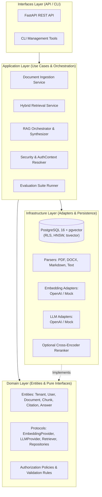
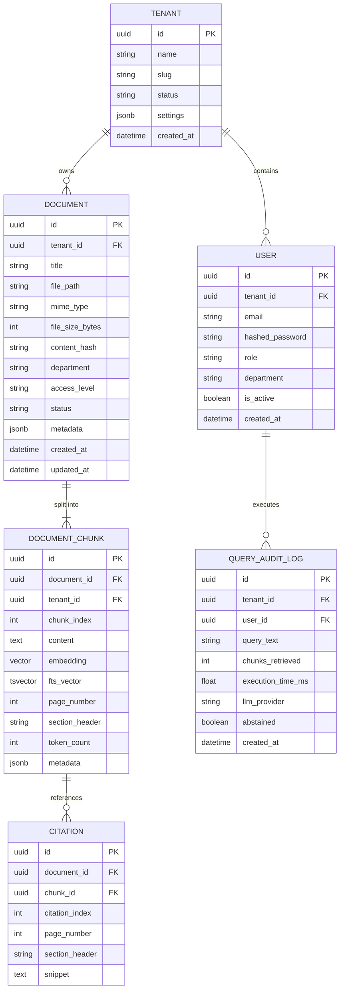
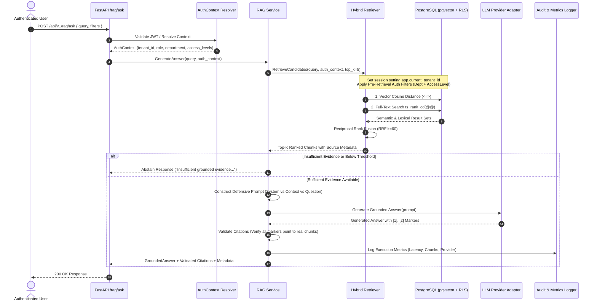
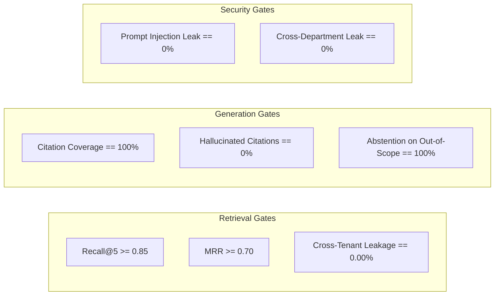

# Enterprise RAG System — Architectural Specification

## 1. Executive Summary & System Purpose

The **Enterprise RAG System** is a production-grade, multi-tenant knowledge retrieval and generation platform engineered for enterprise organizations. Unlike generic conversational chatbots or toy vector search demos, this system addresses critical enterprise requirements:

1. **Grounded Synthesis with Verifiable Citations**: Answers are synthesized strictly from retrieved organizational documents; every factual claim links directly to a verifiable document chunk, section, and page reference.
2. **Deterministic Abstention**: When evidence is absent, ambiguous, or insufficient, the system explicitly abstains rather than hallucinating plausible falsehoods.
3. **Enterprise Multi-Tenancy & Defense-in-Depth**: Complete isolation between client organizations enforced at both the database storage level (PostgreSQL Row-Level Security) and the application authorization layer.
4. **Fine-Grained Document Access Control**: Role-Based (RBAC) and Attribute-Based (ABAC) access control by department (HR, Finance, Engineering, Legal) and classification level (`PUBLIC`, `INTERNAL`, `CONFIDENTIAL`, `RESTRICTED`), applied *pre-retrieval*.
5. **Hybrid Information Retrieval**: Combining dense semantic similarity (pgvector HNSW) with lexical full-text keyword search (PostgreSQL Cover Density Ranking) via Reciprocal Rank Fusion (RRF).
6. **Provider Independence**: Pluggable LLM and embedding adapters allowing seamless switching between OpenAI, Azure, self-hosted open models (Ollama/vLLM), and deterministic offline mock engines without changing core domain logic.
7. **Reproducible Evaluation**: Automated, deterministic evaluation metrics (Recall@K, MRR, citation precision, isolation enforcement, prompt injection resistance) runnable offline without paid API credentials.

---

## 2. High-Level Architecture

The system is structured as a **Modular Monolith** adhering to Clean Architecture and Domain-Driven Design (DDD) principles. The inner domain layer defines business entities and repository protocols, completely isolated from external frameworks, databases, or AI vendors.



### Layer Responsibilities

| Layer | Directory | Responsibilities | Constraints |
| :--- | :--- | :--- | :--- |
| **Domain** | `src/domain/` | Pure business entities, value objects, domain exceptions, and abstract protocols. | **Zero external dependencies**. No SQLAlchemy, no FastAPI, no vendor SDKs. |
| **Application** | `src/application/` | Use cases, DTOs, workflow orchestration, pipeline coordination. | Depends strictly on Domain interfaces; orchestrates operations via dependency injection. |
| **Infrastructure** | `src/infrastructure/` | Database models, SQLAlchemy repositories, pgvector queries, document parsers, LLM/Embedding vendor adapters. | Implements Domain protocols. Encapsulates all I/O and external drivers. |
| **Interfaces** | `src/interfaces/` | HTTP REST endpoints, request/response schemas (Pydantic v2), authentication middleware, error handlers. | Translates external web requests to Application use cases. |
| **Shared** | `src/shared/` | Cross-cutting utilities: structured JSON logger, correlation ID tracking, configuration settings, base types. | Accessible across layers for technical plumbing. |

---

## 3. Domain Model and Entities

### Core Entities



### Entity Specifications

1. **Tenant**
   - Identifier (`id: UUID`): Primary isolation boundary.
   - Slug (`slug: str`): Human-readable unique key (e.g., `acme-corp`).
   - Settings (`settings: dict`): Per-tenant chunking overrides, retention policies, default access classifications.

2. **User & AuthContext**
   - `tenant_id: UUID`: Enforced by JWT / server context.
   - `role: Role` (`admin`, `manager`, `member`, `guest`).
   - `department: Department` (`hr`, `finance`, `engineering`, `legal`, `general`).
   - `access_levels: set[AccessLevel]` (`PUBLIC`, `INTERNAL`, `CONFIDENTIAL`, `RESTRICTED`).

3. **Document**
   - `content_hash: str`: SHA-256 digest of original file for deduplication.
   - `access_level: AccessLevel`: Security tier required to retrieve this document.
   - `department: str`: Organizational department owner.
   - `status: IngestionStatus` (`PENDING`, `PROCESSING`, `INDEXED`, `FAILED`).

4. **DocumentChunk**
   - `chunk_index: int`: Zero-based sequential position.
   - `embedding: list[float]`: 1536-dim or 384-dim dense vector.
   - `fts_vector: str`: PostgreSQL `tsvector` generated with English dictionary stemming.
   - `page_number: Optional[int]`: Extracted PDF/DOCX page offset.
   - `section_header: Optional[str]`: Hierarchical heading context.
   - `token_count: int`: Token length computed via model-appropriate tokenizer.

5. **GroundedAnswer & Citation**
   - `query: str`: User query text.
   - `content: str`: Generated answer incorporating explicit numeric citation markers `[1]`, `[2]`.
   - `citations: list[Citation]`: List of exact retrieved chunks supporting each marker.
   - `confidence_score: float`: Calibrated evidence sufficiency score based on RRF rank and similarity margin.
   - `abstained: bool`: `True` if evidence was insufficient to satisfy the groundedness threshold.

---

## 4. Ingestion and RAG Data Flow



---

## 5. Core Interface Contracts (Domain Protocols)

To guarantee complete provider independence, all external dependencies are expressed as Python `Protocol` or `ABC` definitions in `src/domain/interfaces/`:

### Document Parsing & Chunking
```python
class DocumentParser(Protocol):
    def can_parse(self, mime_type: str) -> bool: ...
    async def parse(self, content: bytes, filename: str) -> ParsedDocument: ...

class Chunker(Protocol):
    def chunk(self, parsed: ParsedDocument, chunk_size: int = 512, overlap: int = 64) -> list[RawChunk]: ...
```

### AI Adapters
```python
class EmbeddingProvider(Protocol):
    async def embed_query(self, text: str) -> list[float]: ...
    async def embed_documents(self, texts: list[str]) -> list[list[float]]: ...
    @property
    def dimension(self) -> int: ...
    @property
    def model_name(self) -> str: ...

class LLMProvider(Protocol):
    async def generate(
        self,
        system_prompt: str,
        user_prompt: str,
        temperature: float = 0.0,
        max_tokens: int = 1024,
    ) -> LLMResponse: ...
    @property
    def model_name(self) -> str: ...
```

### Retrieval & Ranking
```python
class HybridRetriever(Protocol):
    async def retrieve(
        self,
        query: str,
        auth_context: AuthContext,
        top_k: int = 5,
        filters: Optional[RetrievalFilters] = None,
    ) -> list[ScoredChunk]: ...

class Reranker(Protocol):
    async def rerank(
        self,
        query: str,
        candidates: list[ScoredChunk],
        top_n: int = 3,
    ) -> list[ScoredChunk]: ...
```

---

## 6. REST API Contracts

All endpoints use Pydantic v2 schemas and return standardized JSON envelopes.

### Health Endpoints
- `GET /health` -> `{"status": "ok", "version": "1.0.0"}`
- `GET /health/ready` -> Verifies database connectivity and pgvector extension readiness.

### Document Management
- `POST /api/v1/documents/upload`
  - Multipart form upload (`file: UploadFile`, `department: str`, `access_level: str`).
  - Returns `DocumentUploadResponse` (`document_id`, `status: "PENDING"`, `content_hash`).
- `GET /api/v1/documents`
  - Query params: `page`, `page_size`, `department`, `status`.
  - Scoped strictly to caller's `tenant_id`.
- `GET /api/v1/documents/{document_id}`
  - Fetches document metadata and ingestion statistics.
- `DELETE /api/v1/documents/{document_id}`
  - Atomically removes document, associated chunks, and vector embeddings.
- `POST /api/v1/documents/{document_id}/reindex`
  - Re-triggers chunking and embedding generation.

### Retrieval & RAG
- `POST /api/v1/search/hybrid`
  - Request: `{"query": str, "top_k": int, "department": Optional[str]}`
  - Response: `{"chunks": list[ScoredChunkResponse], "execution_time_ms": float}`
- `POST /api/v1/rag/ask`
  - Request: `{"question": str, "top_k": int, "department_filter": Optional[str], "confidence_threshold": float}`
  - Response:
    ```json
    {
      "question": "What is the travel reimbursement limit for meals?",
      "answer": "According to the ACME Expense Policy, meal reimbursements are capped at $75 per day without prior VP approval [1].",
      "abstained": false,
      "confidence_score": 0.88,
      "citations": [
        {
          "citation_index": 1,
          "document_id": "9b1deb4d-3b7d-4bad-9bdd-2b0d7b3dcb6d",
          "document_title": "ACME_Travel_and_Expense_Policy_2026.pdf",
          "page_number": 4,
          "section_header": "Section 3.2 - Daily Meal Allowances",
          "snippet": "Meal reimbursements are capped at $75 per day without prior VP approval..."
        }
      ],
      "execution_metadata": {
        "retrieval_time_ms": 14.2,
        "generation_time_ms": 612.0,
        "embedding_provider": "deterministic-mock",
        "llm_provider": "deterministic-mock",
        "chunks_evaluated": 5
      }
    }
    ```

---

## 7. Security Boundaries & Threat Modeling

| Threat Vector | Mitigation Strategy | Architectural Enforcement |
| :--- | :--- | :--- |
| **Cross-Tenant Data Leakage** | PostgreSQL Row-Level Security (RLS) + server-side JWT tenant resolution. | Database engine enforces `tenant_id = app.current_tenant_id` on all chunk and document queries. |
| **Unauthorized Department Access** | Pre-retrieval SQL filtering based on caller's role clearance. | Chunks from unauthorized departments are filtered out *before* scoring; zero leakage to prompt context. |
| **Prompt Injection via Document Chunks** | Strict role separation, explicit untrusted delimiters, and instruction override guards. | Chunks are wrapped in `<retrieved_context>` XML tags with explicit system prompts forbidding instruction execution from within context. |
| **System Prompt Extraction** | Sanitized system prompts and adversarial test regression suite. | Generation pipeline rejects requests that instruct the model to regurgitate initial configuration. |
| **Credential & Secret Exposure** | Structured logger with automatic regex redaction. | Masks Authorization headers, API keys, and passwords before writing logs to stdout. |

---

## 8. Evaluation Criteria & Quality Gates

The system includes an automated evaluation suite (`tests/evaluation/`) enforcing these quantitative gates:



---

## 9. Implementation Risks & Mitigations

1. **Embedding Dimensionality & Model Drift**:
   - *Risk*: Switching between OpenAI (`text-embedding-3-small`: 1536 dims) and local models (e.g., `all-MiniLM-L6-v2`: 384 dims) crashes existing vector indexes.
   - *Mitigation*: Dimension is declared dynamically on startup via the `EmbeddingProvider` protocol; database migration scripts and collection definitions isolate models by embedding size.
2. **Session Variable Bleed in Connection Pools**:
   - *Risk*: Reusing a database connection without resetting `app.current_tenant_id` could leak data across requests.
   - *Mitigation*: Scoped asynchronous SQLAlchemy session lifecycle resets the variable upon session checkout and release (`DISCARD ALL` / `RESET ALL`).
3. **Citation Fabrication by LLMs**:
   - *Risk*: The LLM hallucinates `[3]` when only 2 chunks were provided.
   - *Mitigation*: Server-side `CitationValidator` parses all returned citation markers and validates them against the candidate chunk set. Any orphaned marker is stripped, and answers with ungrounded claims trigger an abstention fallback.
