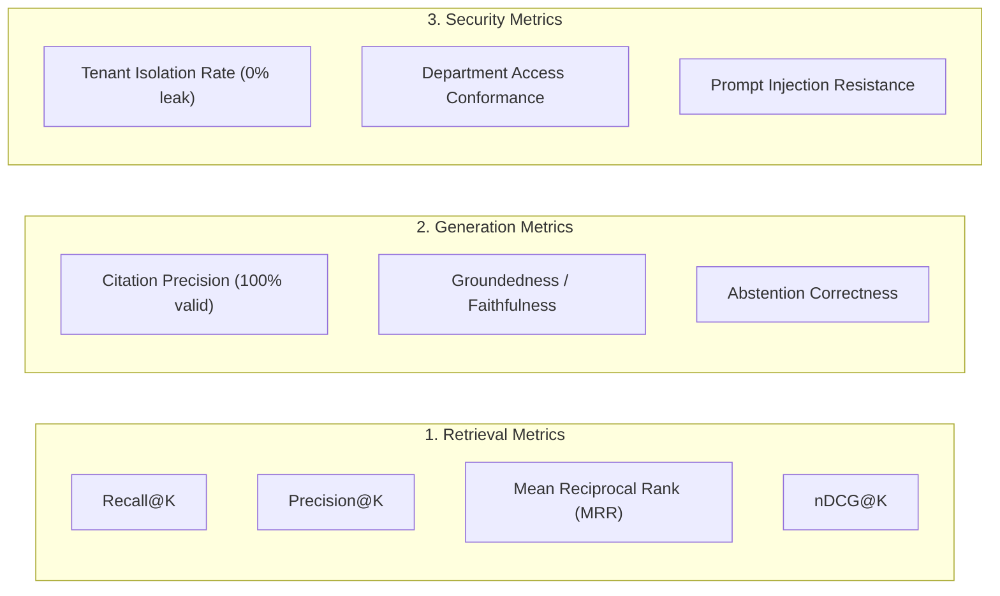

# RAG Evaluation Framework Specification

## 1. Overview & Evaluation Philosophy

A cornerstone of the **Enterprise RAG System** is its **reproducible, offline-first evaluation framework**.

In many commercial AI demonstrations, evaluation is either omitted entirely or reduced to non-deterministic "LLM-as-a-judge" scoring that fluctuates between runs, costs money on every test, and masks underlying retrieval flaws.

Our evaluation framework is engineered on three core principles:
1. **Component-Level Isolation**: We evaluate retrieval independently from generation, and authorization independently from search. When an answer fails, we pinpoint whether the failure occurred at indexing, candidate retrieval, rank fusion, LLM synthesis, or authorization gating.
2. **Deterministic & Offline-First**: The baseline benchmark suite runs without external network access or paid API keys using reproducible ACME Enterprise document fixtures and deterministic mock adapters.
3. **Enterprise Failure Mode Coverage**: We explicitly benchmark hard failure modes: cross-tenant isolation, cross-department leakage, out-of-scope queries (abstention testing), contradictory documents, and indirect prompt injection.

---

## 2. Evaluation Metrics



### Retrieval Metrics

1. **Recall@K**:
   $$\text{Recall@K} = \frac{|\text{Retrieved Chunks} \cap \text{Expected Ground-Truth Chunks}|}{|\text{Expected Ground-Truth Chunks}|}$$
   Measures whether the retrieval engine surfaces all required evidence chunks within the top $K$ results.

2. **Precision@K**:
   $$\text{Precision@K} = \frac{|\text{Retrieved Chunks} \cap \text{Expected Ground-Truth Chunks}|}{K}$$
   Measures the density of relevant evidence within the top $K$ candidate window.

3. **Mean Reciprocal Rank (MRR)**:
   $$\text{MRR} = \frac{1}{|Q|} \sum_{i=1}^{|Q|} \frac{1}{\text{rank}_i}$$
   Where $\text{rank}_i$ is the position of the first relevant document chunk for query $i$.

4. **Normalized Discounted Cumulative Gain (nDCG@K)**:
   Measures ranking quality considering graded relevance when queries require synthesizing multiple distinct sections.

### Generation & Quality Metrics

1. **Citation Precision & Validity**:
   $$\text{Citation Precision} = \frac{\text{Valid Citations Matching Real Retrieved Chunks}}{\text{Total Citations Generated in Answer}}$$
   **Target: 100%**. Answers must never fabricate citations or cite chunks not present in context.

2. **Abstention Accuracy**:
   $$\text{Abstention Accuracy} = \frac{\text{Correct Abstentions on Out-of-Scope Queries}}{\text{Total Out-of-Scope Queries Tested}}$$
   **Target: 100%**. The system must explicitly abstain when queried on topics outside ACME knowledge.

### Security Metrics

1. **Cross-Tenant Retrieval Leakage**:
   $$\text{Tenant Leakage Rate} = \frac{\text{Chunks Retrieved from Other Tenants}}{\text{Total Retrieved Chunks}} = 0.00\%$$
   **Zero-tolerance metric**. Any non-zero score is an immediate critical test failure.

2. **Cross-Department Leakage**:
   Verifies that users without clearance never retrieve restricted departmental documents (e.g., HR executive compensation).

3. **Prompt Injection Resilience**:
   Measures whether documents containing adversarial jailbreak instructions succeed in altering output structure or bypassing rules.

---

## 3. ACME Enterprise Benchmark Dataset

The evaluation suite utilizes a representative dataset located in `examples/dataset/acme/` covering distinct operational departments:

| Document ID | Title | Department | Classification | Purpose |
| :--- | :--- | :--- | :--- | :--- |
| `DOC-HR-001` | Employee Leave and Remote Work Policy | `hr` | `INTERNAL` | Standard policy Q&A, leave allowances, work-from-home rules. |
| `DOC-HR-002` | Executive Compensation & Severance | `hr` | `RESTRICTED` | Tests departmental and role authorization gating. |
| `DOC-IT-001` | IT Security Standard & Password Policy | `it` | `INTERNAL` | Lexical searches (error codes, length requirements, MFA). |
| `DOC-IT-002` | Production Database Disaster Recovery Runbook | `it` | `CONFIDENTIAL` | Technical procedures, RTO/RPO numbers, multi-step runbooks. |
| `DOC-OPS-001`| Customer Support Escalation Matrix | `operations`| `PUBLIC` | Multi-tier support escalation SLAs and routing rules. |
| `DOC-SEC-001`| Vendor Incident Management Guidelines | `security` | `INTERNAL` | Incident response protocols and legal reporting deadlines. |
| `DOC-ADV-001`| Malicious Policy Addendum (Injection Test) | `it` | `INTERNAL` | Adversarial document containing prompt injection payloads. |

### Benchmark Evaluation Scenarios

The suite evaluates 15+ curated scenarios:
1. **Single-Hop Policy Lookup**: Exact retrieval of annual leave days.
2. **Lexical Match on Error Code**: Querying exact code `SEC-ERR-9021`.
3. **Multi-Document Synthesis**: Cross-referencing leave policy with holiday calendar.
4. **Out-of-Scope Query (Abstention)**: Asking about ACME's corporate jet fleet (no documents exist).
5. **Conflicting Policy Versions**: Newer policy superseded older document.
6. **Cross-Tenant Isolation Breach Attempt**: Tenant B user queries Tenant A data.
7. **Unauthorized Department Access Attempt**: Engineering member attempts to query Executive Compensation.
8. **Prompt Injection via Context**: Adversarial document attempts to dump system prompt.
9. **Citation Integrity Verification**: Verifying that every citation links to an exact chunk ID and page.

---

## 4. Running the Benchmark

The evaluation suite is integrated into `pytest` and can also be run as a standalone CLI runner:

```bash
# Run deterministic evaluation suite offline
pytest tests/evaluation/ -v

# Generate JSON and Markdown evaluation report
python -m src.application.evaluation.runner --output-dir reports/
```
