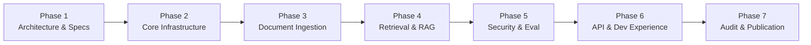

# Enterprise RAG System — Comprehensive Implementation Plan

## 1. Overview & Phased Roadmap

This document outlines the detailed execution plan for building, testing, auditing, and publishing the **Enterprise RAG System**. To guarantee engineering quality, each phase has clear deliverables, acceptance criteria, and automated verification gates.

---

## 2. Phase-by-Phase Work Breakdown

### Phase 1 — Architecture and Specification (Current)
- [x] Inspect environment and verify target repository directory.
- [x] Author Architecture Decision Records (ADRs):
  - [x] ADR 0001: PostgreSQL and pgvector for Unified Vector and Relational Storage.
  - [x] ADR 0002: Hybrid Retrieval Engine with Reciprocal Rank Fusion (RRF).
  - [x] ADR 0003: Document Ingestion and Chunking Strategy.
  - [x] ADR 0004: Enterprise Multi-Tenancy and Row-Level Security (RLS).
  - [x] ADR 0005: Provider-Agnostic LLM and Embedding Adapters.
  - [x] ADR 0006: Reproducible Offline Evaluation Framework.
- [x] Author core architecture specification (`docs/architecture.md`).
- [x] Author RAG pipeline specification (`docs/rag-pipeline.md`).
- [x] Author security & multi-tenancy specification (`docs/security.md`).
- [x] Author evaluation methodology specification (`docs/evaluation.md`).
- [x] Author developer guide (`docs/development.md`).
- [x] Establish Phase 2–7 work breakdown and verification gates.

### Phase 2 — Core Infrastructure & Domain Foundation
- **Target Deliverables**:
  - `pyproject.toml` with Ruff, mypy, pytest, and dependencies.
  - Domain layer: Entities (`Tenant`, `User`, `Document`, `DocumentChunk`, `Citation`, `GroundedAnswer`), Value Objects, Domain Exceptions, Protocols.
  - Configuration manager (`src/shared/config.py`) using `pydantic-settings`.
  - Structured JSON logger with correlation ID tracking and secret masking (`src/shared/logging.py`).
  - Asynchronous SQLAlchemy 2.0 database engine and session factory (`src/infrastructure/database/session.py`).
  - Database models mapping domain entities with pgvector `Vector` and PostgreSQL `TSVECTOR` types.
  - PostgreSQL Row-Level Security (RLS) migration scripts via Alembic.
  - Authentication and authorization context resolver (`AuthContextService`, JWT handler, RBAC/ABAC policy engine).
  - Unit tests for domain entities, policies, configuration, and architecture boundaries (`tests/unit/`).

### Phase 3 — Document Ingestion Pipeline
- **Target Deliverables**:
  - File validators (MIME type magic bytes, size limits, format checks).
  - Extractors & parsers for PDF (`pypdf` / `pymupdf`), DOCX (`python-docx`), Markdown, and plaintext.
  - Text normalizer (Unicode normalization, whitespace collapsing, header detection).
  - Structure-preserving recursive chunker (`src/domain/services/chunker.py`) retaining page numbers, section titles, and token counts.
  - SHA-256 deduplication and idempotent document indexing service (`src/application/ingestion/`).
  - Pluggable embedding adapters (`DeterministicMockEmbeddingAdapter`, `OpenAICompatibleEmbeddingAdapter`).
  - Batch persistence to PostgreSQL with transactional rollback on failure.
  - Document deletion cascading (removes document, chunks, embeddings, and FTS vectors).
  - Comprehensive unit and integration tests for parsers, chunking, deduplication, and persistence (`tests/unit/ingestion/`).

### Phase 4 — Hybrid Retrieval & Grounded Generation
- **Target Deliverables**:
  - Dense semantic retrieval via pgvector cosine distance (`<=>`).
  - Lexical full-text search via PostgreSQL `tsvector` and `ts_rank_cd`.
  - Reciprocal Rank Fusion (RRF with $k=60$) rank fusion engine.
  - Pre-retrieval authorization filters applying tenant, department, and classification rules at SQL query time.
  - Pluggable cross-encoder reranking interface (`Reranker`).
  - Pluggable LLM adapters (`DeterministicMockLLMAdapter`, `OpenAICompatibleLLMAdapter`).
  - Defensive prompt construction (demoting untrusted context chunks, isolating user question).
  - Server-side `CitationValidator` verifying that 100% of generated citation markers link to actual retrieved chunks.
  - Groundedness evaluation and confidence threshold abstention logic.
  - Integration tests verifying retrieval, RRF fusion, generation, and citation validity (`tests/integration/`).

### Phase 5 — Enterprise Security & Automated Evaluation Framework
- **Target Deliverables**:
  - PostgreSQL Row-Level Security test suite proving zero cross-tenant data leakage under intentional bypass attempts (`tests/security/test_tenant_isolation.py`).
  - Document authorization test suite verifying department boundaries and clearance restrictions (`tests/security/test_document_authorization.py`).
  - Adversarial prompt injection test suite verifying that malicious instructions inside documents cannot override system rules (`tests/security/test_prompt_injection.py`).
  - Representative ACME Enterprise knowledge dataset in `examples/dataset/acme/` (HR policies, IT standards, runbooks, customer support escalation).
  - Evaluation harness (`src/application/evaluation/`) computing Recall@K, Precision@K, MRR, nDCG, Citation Coverage, and Abstention Accuracy.
  - Automated evaluation report generator producing Markdown and JSON summaries (`tests/evaluation/`).

### Phase 6 — REST API, Developer Experience & CLI
- **Target Deliverables**:
  - FastAPI application (`src/interfaces/api/main.py`) with clean routing:
    - `/health`, `/health/ready`
    - `/api/v1/documents/*` (upload, list, get, delete, reindex, status)
    - `/api/v1/search/hybrid`, `/api/v1/search/semantic`
    - `/api/v1/rag/ask`
    - `/api/v1/admin/*`
  - OpenAPI 3.1 documentation with request/response schemas and examples.
  - CLI management tool (`src/interfaces/cli.py`) for database seeding, evaluation runs, and health checks.
  - Production-ready `Dockerfile` (multi-stage non-root build) and `docker-compose.yml` (PostgreSQL with pgvector + web service).
  - `.env.example` documenting all configuration parameters.
  - Example HTTP requests (`examples/requests/`).
  - Professional public GitHub `README.md` with system overview, architecture diagram, setup instructions, and portfolio positioning.

### Phase 7 — Comprehensive Audit, Validation & Publication
- **Target Deliverables**:
  - Full automated test suite execution (`pytest` across unit, integration, security, evaluation).
  - Static type checking with `mypy` (zero errors).
  - Code formatting and linting audit with `Ruff` (zero errors).
  - Secret scanning audit (verify no hardcoded credentials, API keys, or private tokens).
  - Licensing audit (MIT License verified against dependencies).
  - Initialize clean Git repository at `C:\Users\leono\Proyectos\Enterprise-RAG-System-Public`.
  - Initial commit: `chore: initialize enterprise RAG portfolio showcase`.
  - Create public GitHub repository under `leonoriegag/Enterprise-RAG-System` and push `main`.
  - Generate comprehensive final report summarizing architecture, capabilities, validation results, and portfolio impact.

---

## 3. Verification Gates Summary

| Milestone | Target Phase | Criteria for Progression |
| :--- | :--- | :--- |
| **M1: Architecture Sign-off** | Phase 1 | All ADRs, pipeline specs, security models, evaluation criteria, and implementation plan documented. |
| **M2: Core Infrastructure** | Phase 2 | Domain entities, clean architecture boundaries, async database session, and RLS schema tested and passing. |
| **M3: Ingestion Complete** | Phase 3 | Multi-format parsing, chunking with metadata, deduplication, and vector storage working end-to-end. |
| **M4: Hybrid RAG Operational**| Phase 4 | Semantic + lexical RRF retrieval, grounded synthesis, and citation verification passing tests. |
| **M5: Security & Eval Verified**| Phase 5 | 0% tenant leakage, prompt injection defenses validated, evaluation benchmarks executed with real metrics. |
| **M6: API & Packaging Ready** | Phase 6 | FastAPI endpoints, Swagger docs, CLI seeder, Docker Compose, and README completed. |
| **M7: Final Audit & Published**| Phase 7 | 100% test pass rate, Ruff/mypy clean, secrets scanned, public GitHub repository published. |
